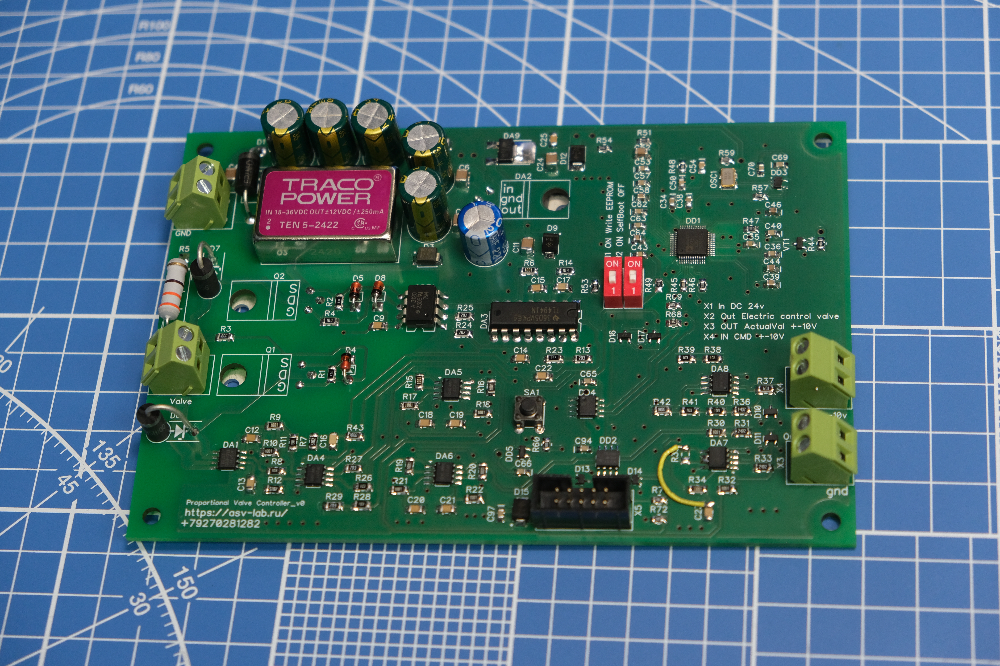
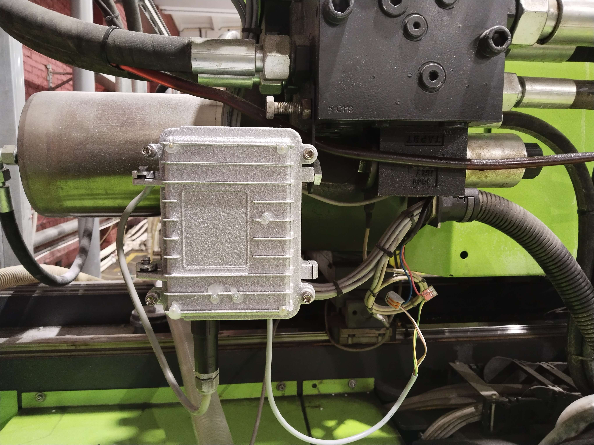
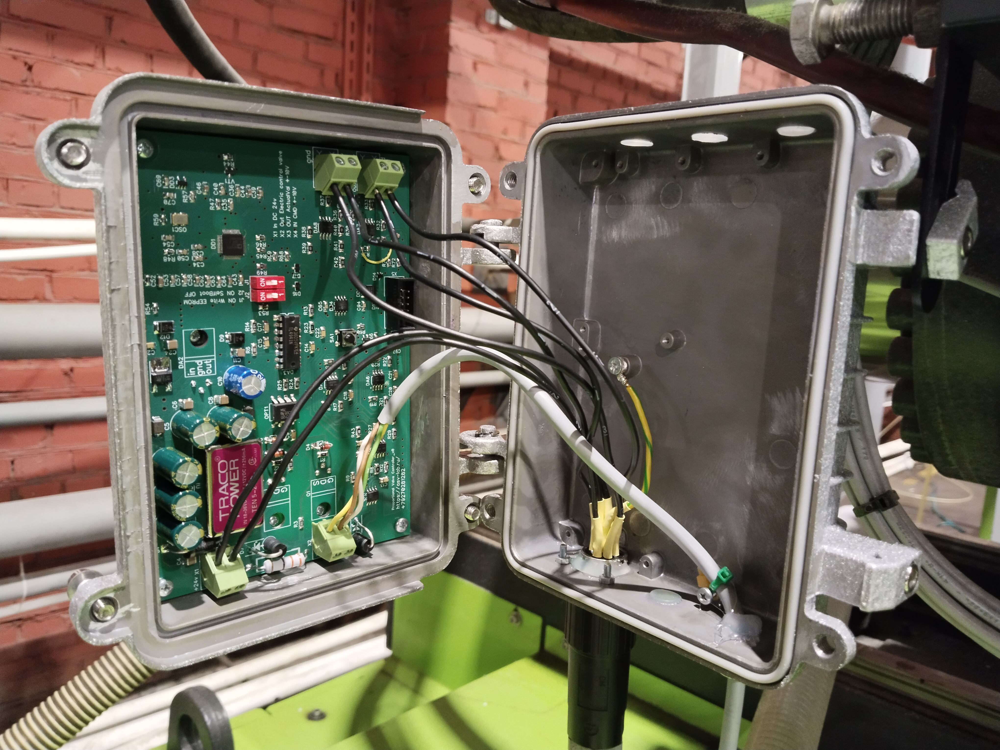
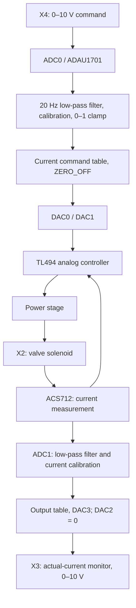

# PropValve: Parker RE06M*T control with ADAU1701

[Русский](README.md) | **English**

Repository: [neuroandriyanov/PropValve-RE06MT](https://github.com/neuroandriyanov/PropValve-RE06MT).

A remote board replacing the original electronics of a Parker **RE06M*T** proportional valve. The distinctive feature is an **ADAU1701 SigmaDSP audio processor handling DC control signals**, filtering, calibration and valve diagnostics.

The original board was mounted directly on the valve and became very hot as the valve heated up. This design moves the board away from that heat. Transfer characteristics are adjusted and signals observed in **SigmaStudio**, where the control path is displayed as a functional block diagram.



[Bottom view of the board](фото/PCB_BOTTOM.JPG)

## Enclosure



*Control unit enclosure installed on the machine.*



*Control board in its enclosure with the lid open.*


Image of the **RUICHI A09** enclosure. The end-cap files and a description of the contents are in the [enclosure folder](корпус/README.en.md).

## How it works



A hardware analog loop based on the TL494 regulates current. The DSP sets the requested current, processes measurements and generates the monitoring signal.

| Parameter | Saved configuration |
| --- | --- |
| DSP / environment | ADAU1701 / SigmaStudio 4.7 |
| Project sample rate | 96 kHz |
| Board supply according to the schematic | X1, 24 V DC |
| Command input | X4, 0–10 V, ADC0 |
| Calibrated current-command scale | 0–3 A |
| Current measurement | ACS712, ADC1 |
| Monitor output | X3, 0–10 V proportional to actual current |
| ADC input resistors | R42 = R43 = 10 kΩ for this calibration |

Within the scale, `I_command = 3 × U_X4 / 10` and `U_X3 = 10 × I_actual / 3`. These are the scales of this board and its bench calibration. They **do not establish the permissible current of every RE06M*T valve** and do not set pressure in bar. The valve variant and the current limit of the particular coil must be established separately.

## Work completed

- The board has been moved away from the hot valve body and installed on the machine. The author confirmed that no board heating was observed.
- An audio DSP handles DC control signals and diagnostics through SigmaStudio.
- The 0–10 V output, current command, current measurement and 0–10 V input have been calibrated.
- Replacing R43 eliminated measurement-channel saturation; R42 was also replaced with 10 kΩ.
- Low-pass filters and clamps were added before the current-measurement table because the interpolator's behavior outside its range caused incorrect readings.
- The PDF schematic, Gerber files, tables, reports and direct multimeter-reading tools are available.

The saved project files and calibration records are dated **27 October 2026**. On **31 October 2026**, the author clarified that the board was operating on the machine without observed heating. This supersedes earlier notes about the need to test the combined signal path. Details: [current status and calibration history](docs/STATUS.en.md).

## Getting started

1. Read the [setup instructions](docs/SETUP.en.md) and [hardware notes](схема_плата/README.en.md).
2. Open the [English schematic](схема_плата/schematic.en.pdf), its [translation notes](схема_плата/schematic-notes.en.md), and the [Parker documentation](doc/Parker-Series-RE06MT.pdf).
3. Use **[проект_сигма/Design1_parker_v0.dspproj](проект_сигма/Design1_parker_v0.dspproj)**. The word `calibrated` in another copy's filename does not mean it is newer.
4. To work with an AI assistant, open this folder's root and have the assistant read [AGENTS.en.md](AGENTS.en.md).

File checks without SigmaStudio, USB or board power (Python 3.11+):

```powershell
py -3 tools/check_project.py
py -3 tools/sigma/inspect_project.py
py -3 -m unittest discover -s tools/meter -p "test_*.py" -v
```

On Linux/macOS, `python3` can be used for these three commands. Live SigmaStudio control and USB/HID meter reading require Windows. Checking files does not confirm the state of connected hardware.

## Contents

| Path | Purpose |
| --- | --- |
| `фото/` | Four original photos: both board sides, the enclosure on the machine, and the board in its enclosure |
| `схема_плата/` | PDF schematic, Gerber/drill files and BOM; DipTrace files and libraries were excluded by the author |
| `doc/` | Documentation for the Parker valve being modified |
| `проект_сигма/` | Working project, reference copies, tables and saved compiler outputs |
| `корпус/` | RUICHI A09 image, end-cap files and description |
| `measurements/2026-10-27/` | Historical measurements, including intermediate series |
| `tools/` | Package validation, project inspection, multimeter tools and SigmaStudio bridge source |
| `docs/` | Setup, status, inventory and checksums |
| `archive/` | Original transfer log, old scripts and unverified EEPROM images |

[Original-folder review and transfer decisions](docs/INVENTORY.en.md). Manufacturer software and compiled EXE/DLL files are not included. Terms for using the materials: [licenses and notices](NOTICE.en.md).

## Languages and updates

New material is published in Russian first, then translated into the adjacent English file. [Publication and translation workflow](docs/TRANSLATION.en.md). English hardware files: [BOM](схема_плата/Спецификация_для_пайк.en.xlsx) and [schematic](схема_плата/schematic.en.pdf).
