# PropValve: controlling Parker RE06M*T with ADAU1701

[Русский](README.md) | English

Repository: [neuroandriyanov/PropValve-RE06MT](https://github.com/neuroandriyanov/PropValve-RE06MT).

A remote board replacing the original electronics of a Parker **RE06M*T** proportional valve. The distinctive feature is using an **ADAU1701 SigmaDSP audio processor for DC control signals**, filtering, calibration and valve diagnostics.

The original board was mounted directly on the valve and became very hot as the valve heated up. In this design, the board is moved away from that heat. Transfer characteristics are adjusted and signals observed in **SigmaStudio**, where the control path is presented as a diagram of functional blocks.


[Photograph of the underside](фото/PCB_BOTTOM.JPG)

## Enclosure


*Control enclosure installed on the machine.*


*Control board inside the enclosure, with the lid open.*


Image of the **RUICHI A09** enclosure. The blanking-part files and a description of the contents are in the [enclosure directory](корпус/README.en.md).

## How it works

```mermaid
flowchart LR
    X4["X4: 0–10 V command"] --> ADC0["ADC0 / ADAU1701"]
    ADC0 --> VIN["20 Hz LPF, calibration, 0–1 limiting"]
    VIN --> CMD["Current-command table, ZERO_OFF"]
    CMD --> DAC01["DAC0 / DAC1"]
    DAC01 --> TL["TL494 analog current controller"]
    TL --> POWER["Power stage"]
    POWER --> COIL["X2: valve solenoid"]
    COIL --> ACS["ACS712: current measurement"]
    ACS --> TL
    ACS --> ADC1["ADC1: LPF and current calibration"]
    ADC1 --> OUT["Output table, DAC3; DAC2 = 0"]
    OUT --> X3["X3: 0–10 V actual-current monitor"]
```



Current is regulated by the hardware analog loop built around TL494. The DSP sets the requested current, processes measurements and produces the monitor signal.

| Parameter | Saved configuration |
| --- | --- |
| DSP / environment | ADAU1701 / SigmaStudio 4.7 |
| Project sample rate | 96 kHz |
| Board supply in the schematic | X1, 24 V DC |
| Command input | X4, 0–10 V, ADC0 |
| Calibrated current-command scale | 0–3 A |
| Current measurement | ACS712, ADC1 |
| Monitor output | X3, 0–10 V representing actual current |
| ADC input resistors | R42 = R43 = 10 kΩ for this calibration |

Within this scale, `I_command = 3 × U_X4 / 10` and `U_X3 = 10 × I_actual / 3`. This is the scale of this board and its bench calibration. It **does not establish the permissible current of every RE06M*T valve**, nor does it set pressure in bar. The valve variant and the current limit of the particular coil must be established separately.

## Work completed

- The board was moved away from the heat of the valve body and installed on the machine. The author reported no observed board heating.
- An audio DSP is used for DC control and diagnostics through SigmaStudio.
- The 0–10 V output, current command, current measurement and 0–10 V input were calibrated.
- Replacing R43 eliminated saturation of the measurement channel; R42 was also replaced with 10 kΩ.
- Low-pass filters and limiters were added before the current-measurement table because the interpolator produced incorrect readings outside its range.
- The schematic PDF, Gerber files, tables, records and direct multimeter-reading tools have been prepared.

The saved project files and calibration records are dated **27 October 2026**. On **31 October 2026**, the author clarified that the board was working on the machine without observed heating. This updates the earlier records that said the combined path still needed testing. See [current status and calibration history](docs/STATUS.en.md).

## Where to start

1. Read the [setup instructions](docs/SETUP.en.md) and [hardware notes](схема_плата/README.en.md).
2. Open the [schematic](схема_плата/схема.pdf), its [English annotation guide](схема_плата/ANNOTATIONS.en.md), and the [Parker documentation](doc/Parker-Series-RE06MT.pdf).
3. Use **[проект_сигма/Design1_parker_v0.dspproj](проект_сигма/Design1_parker_v0.dspproj)**. The word `calibrated` in another filename does not make that copy newer.
4. To work with AI, open this repository root and ask the assistant to read [AGENTS.md](AGENTS.md) and its [English translation](AGENTS.en.md).

Check files without SigmaStudio, USB or board power (Python 3.11+):

```powershell
py -3 tools/check_project.py
py -3 tools/sigma/inspect_project.py
py -3 -m unittest discover -s tools/meter -p "test_*.py" -v
```

On Linux/macOS, these three commands can use `python3`. Live SigmaStudio control and USB/HID readings require Windows. File checks do not confirm the state of a connected device.

## Contents

| Path | Purpose |
| --- | --- |
| `фото/` | Four original photographs: both board sides, enclosure on the machine and board inside the enclosure |
| `схема_плата/` | Schematic PDF, Gerber/drill files and BOM; DipTrace files and libraries were excluded by the author |
| `doc/` | Documentation for the Parker valve being modified |
| `проект_сигма/` | Working project, reference copies, tables and saved compilation output |
| `корпус/` | RUICHI A09 image, blanking-part files and description |
| `measurements/2026-10-27/` | Historical measurements, including intermediate series |
| `tools/` | Package checks, project inspection, multimeter tools and SigmaStudio bridge source |
| `docs/` | Setup, status, inventory and checksums |
| `archive/` | Original handoff log, old scripts and unverified EEPROM images |

[Original-folder inventory and packaging decisions](docs/INVENTORY.en.md). Vendor software and compiled EXE/DLL files are not included. Terms of use: [licenses and notices](NOTICE.en.md).

English companions retain the original measurements and hardware files. See the [measurement guide](measurements/README.en.md), [calibration reports](проект_сигма/README.en.md) and [translation workflow](docs/TRANSLATIONS.en.md).
