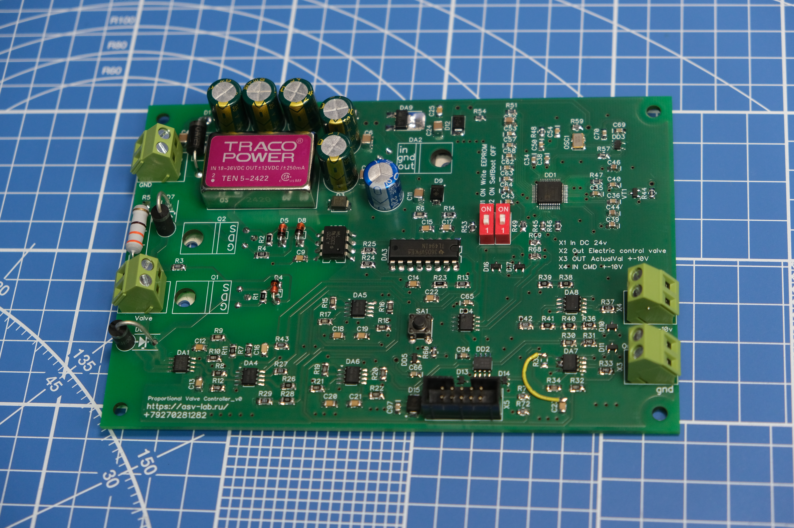

# PropValve: управление Parker RE06M*T на ADAU1701

Репозиторий: [neuroandriyanov/PropValve-RE06MT](https://github.com/neuroandriyanov/PropValve-RE06MT). Текущая видимость — **Private**.

Выносная плата для замены штатной электроники пропорционального клапана. Parker серии **RE06M*T**. Особенность проекта — использование аудиопроцессора **ADAU1701 SigmaDSP для обработки постоянных сигналов управления**, фильтрации, калибровки и диагностики клапана.

Штатная плата располагалась непосредственно на нагревающемся клапане и сильно нагревалась. В этой конструкции плата вынесена из зоны нагрева. Настройка передаточных характеристик и наблюдение за сигналами выполняются в **SigmaStudio**, где цепь управления видна как схема из функциональных блоков.



[Фото обратной стороны платы](фото/PCB_BOTTOM.JPG)

## Корпус


Добавленное автором изображение корпуса **RUICHI A09**. На нём видны ребристая крышка с винтовым креплением и монтажные проушины. Файлы заглушки и описание содержимого находятся в [папке корпуса](корпус/README.md).

## Как это работает

```mermaid
flowchart LR
    X4["X4: задание 0–10 В"] --> ADC0["ADC0 / ADAU1701"]
    ADC0 --> VIN["ФНЧ 20 Гц, калибровка, ограничение 0–1"]
    VIN --> CMD["Таблица задания тока, ZERO_OFF"]
    CMD --> DAC01["DAC0 / DAC1"]
    DAC01 --> TL["Аналоговый регулятор TL494"]
    TL --> POWER["Силовой каскад"]
    POWER --> COIL["X2: соленоид клапана"]
    COIL --> ACS["ACS712: измерение тока"]
    ACS --> TL
    ACS --> ADC1["ADC1: ФНЧ и калибровка тока"]
    ADC1 --> OUT["Таблица выхода, DAC3; DAC2 = 0"]
    OUT --> X3["X3: контроль фактического тока 0–10 В"]
```



Ток регулирует аппаратный аналоговый контур на TL494. DSP задаёт требуемый ток, обрабатывает измерения и формирует сигнал контроля. Цифровой ПИ/ПИД-регулятор в сохранённом проекте не реализован.

| Параметр | Сохранённая конфигурация |
| --- | --- |
| DSP / среда | ADAU1701 / SigmaStudio 4.7 |
| Частота проекта | 96 кГц |
| Питание платы по схеме | X1, 24 В DC |
| Вход команды | X4, 0–10 В, ADC0 |
| Калиброванная шкала задания тока | 0–3 А |
| Измерение тока | ACS712, ADC1 |
| Выход контроля | X3, 0–10 В по фактическому току |
| Входные резисторы ADC | R42 = R43 = 10 кОм для данной калибровки |

В пределах шкалы `Iзад = 3 × U_X4 / 10`, `U_X3 = 10 × Iфакт / 3`. Это шкала данной платы и проведённой стендовой калибровки. Она **не устанавливает допустимый ток любого клапана RE06M*T** и не задаёт давление в барах. Исполнение клапана и предел тока конкретной катушки необходимо установить отдельно.

## Что уже сделано

- Плата вынесена из зоны нагрева корпуса клапана, установлена на машине и прошла испытания. Автор подтвердил отсутствие наблюдаемого нагрева платы.
- Аудио DSP применён для управления постоянными сигналами и диагностики через SigmaStudio.
- Откалиброваны выход 0–10 В, задание тока, измерение тока и вход 0–10 В.
- Устранено насыщение измерительного канала после замены R43; R42 также заменён на 10 кОм.
- Добавлены ФНЧ и ограничители перед таблицей измерения тока, поскольку поведение интерполятора за пределами диапазона давало ошибочные показания.
- Подготовлены схема PDF, Gerber, таблицы, протоколы и инструменты прямого чтения мультиметра.

Сохранённые файлы проекта и протоколы калибровки датированы **27 октября 2026 года**. **31 октября 2026 года** автор уточнил, что плата уже прошла испытания и работает на машине без наблюдаемого нагрева. Эта информация обновляет прежние записи о необходимости испытания объединённой цепи. Подробности: [текущее состояние и история калибровки](docs/STATUS.md).

## С чего начать

1. Прочитать [инструкцию запуска](docs/SETUP.md) и [замечания к аппаратной части](схема_плата/README.md).
2. Открыть [схему](схема_плата/схема.pdf) и [документацию Parker](doc/Parker-Series-RE06MT.pdf).
3. Использовать **[проект_сигма/Design1_parker_v0.dspproj](проект_сигма/Design1_parker_v0.dspproj)**. Слово `calibrated` в имени другой копии не означает более новую версию.
4. Для работы с ИИ открыть корень этой папки и дать ассистенту прочитать [AGENTS.md](AGENTS.md).

Проверка файлов без SigmaStudio, USB и питания платы (Python 3.11+):

```powershell
py -3 tools/check_project.py
py -3 tools/sigma/inspect_project.py
py -3 -m unittest discover -s tools/meter -p "test_*.py" -v
```

На Linux/macOS для этих трёх команд можно использовать `python3`. Живое управление SigmaStudio и USB/HID-чтение прибора требуют Windows. Проверка файлов не подтверждает состояние подключённого устройства.

## Состав

| Путь | Назначение |
| --- | --- |
| `фото/` | Два оригинальных фото без изменений |
| `схема_плата/` | Схема PDF, Gerber/сверловка и спецификация; файлы DipTrace и библиотеки исключены автором |
| `doc/` | Документация модернизируемого клапана Parker |
| `проект_сигма/` | Рабочий проект, контрольные копии, таблицы и сохранённые результаты компиляции |
| `корпус/` | Изображение RUICHI A09, файлы заглушки и описание |
| `measurements/2026-10-27/` | Исторические измерения, включая промежуточные серии |
| `tools/` | Проверка пакета, просмотр проекта, мультиметр, исходник моста SigmaStudio |
| `docs/` | Запуск, состояние, состав и контрольные суммы |
| `archive/` | Исходный журнал переноса, старые сценарии, непроверенные образы EEPROM |

[Обзор исходной папки и решения по переносу](docs/INVENTORY.md). Программы производителей и собранные EXE/DLL не входят в пакет. Выбор лицензии автором пока не зафиксирован: [примечания к материалам](NOTICE.md).
